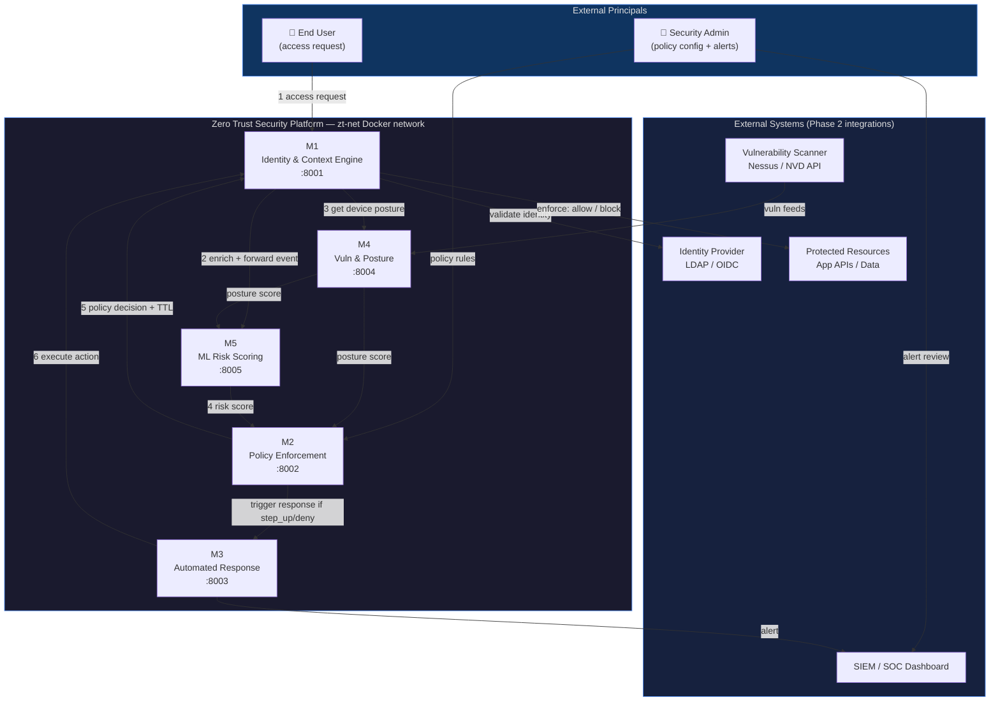
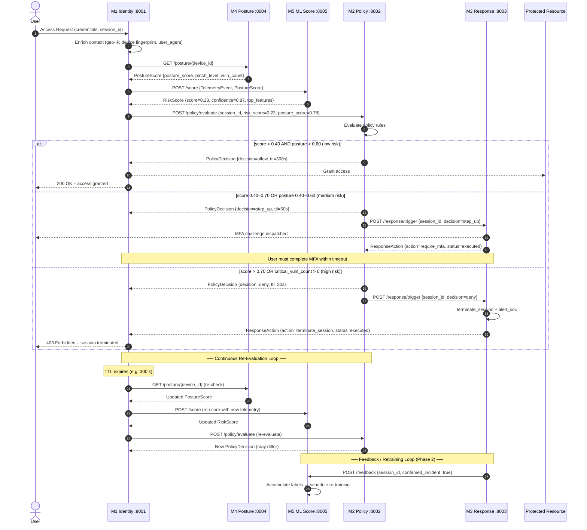
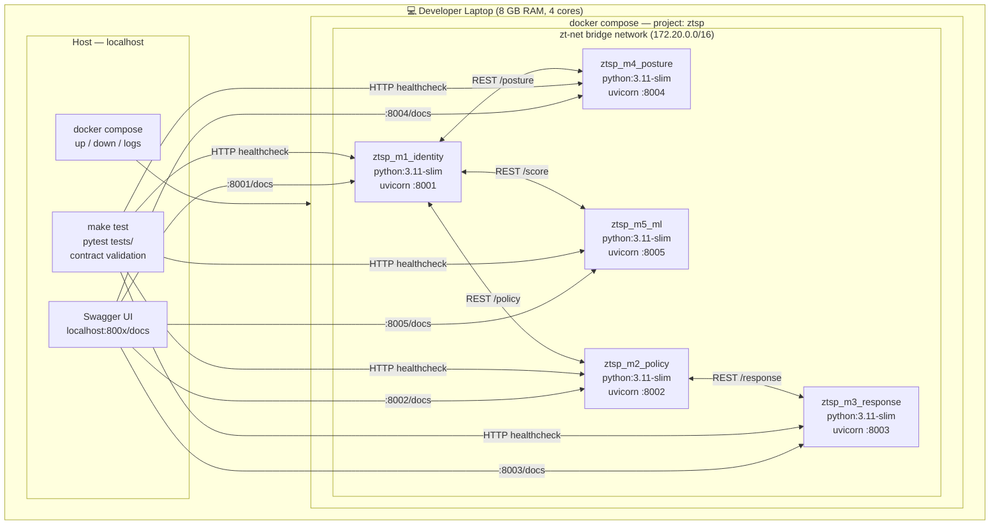

# 04 – Architecture

**Project**: AI-Augmented Zero Trust Security Orchestration Platform
**Phase**: 1 – Research, Requirements & Design

---

## 1. Design Principles

1. **Never trust, always verify** – access is never implicitly granted based on network location.
2. **Least privilege per session** – M2 grants the minimum required access, enforced by TTL.
3. **Assume breach** – M3 treats every anomaly as a potential breach and responds automatically.
4. **Continuous re-evaluation** – policy decisions expire; the loop restarts on every TTL.
5. **Auditability by design** – every decision and action is time-stamped and linked by `session_id`.

---

## 2. System Context Diagram

> Shows who interacts with the platform and what external systems it integrates with.



---

## 3. Access-Decision Sequence Diagram

> Traces one complete access-decision loop from user request to enforcement,
> including the continuous re-evaluation trigger.



---

## 4. Deployment Diagram

> Shows how the five services are packaged and networked in the Docker testbed.



---

## 5. Continuous Re-Evaluation Loop

The re-evaluation loop is the core Zero Trust mechanism. It is driven by the `ttl_seconds` field in every `PolicyDecision`:

```
TTL expiry
   │
   ▼
M1: re-request posture (M4) + re-score (M5)
   │
   ▼
M2: re-evaluate policy with fresh inputs
   │
   ├─ same decision → reset TTL, continue
   └─ changed decision → enforce new decision + trigger M3 if needed
```

TTL is inversely proportional to risk (shorter TTL = more frequent checks for high-risk sessions):

| Risk Level | Score Range | Typical TTL |
|---|---|---|
| Low | 0.00 – 0.39 | 300 s (5 min) |
| Medium | 0.40 – 0.69 | 60 s (1 min) |
| High | 0.70 – 1.00 | 30 s |

---

## 6. NIST SP 800-207 Alignment Notes

> [TO VERIFY – search: "NIST SP 800-207 zero trust architecture seven tenets"]

| NIST 800-207 Tenet | ZTSP Component |
|---|---|
| All data sources treated as resources | M4 includes device posture as a resource to protect |
| All communication secured | Phase 2: HTTPS/mTLS on all inter-module channels |
| Access per-session | M2 issues per-session decisions with TTL |
| Access determined dynamically | M2 re-evaluates on every TTL expiry |
| Device integrity considered | M4 posture_score feeds M2 decisions |
| Authentication and authorisation dynamically enforced | M1 enforces M2 decision; M3 responds to changes |
| Telemetry collected for improvement | M1 streams events; M5 uses them for re-training (Phase 2) |

---

*Document owner: Architecture lead (shared). Diagrams auto-rendered by GitHub Mermaid.*
